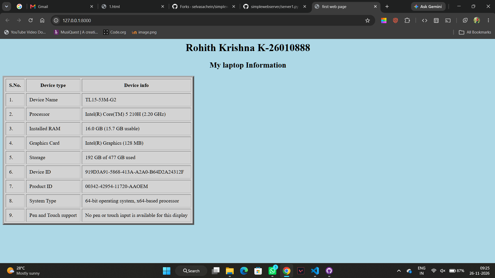

# EX01 Developing a Simple Webserver
## Date:15-11-26

## AIM:
To develop a simple webserver to serve html pages and display the Windows Specifications of your Laptop.

## DESIGN STEPS:
### Step 1: 
HTML content creation.

### Step 2:
Design of webserver workflow.

### Step 3:
Implementation using Python code.

### Step 4:
Import the necessary modules.

### Step 5:
Define a custom request handler.

### Step 6:
Start an HTTP server on a specific port.

### Step 7:
Run the Python script to serve web pages.

### Step 8:
Serve the HTML pages.

### Step 9:
Start the server script and check for errors.

### Step 10:
Open a browser and navigate to http://127.0.0.1:8000 (or the assigned port).

## PROGRAM:
```html
 <html>
    <head>
        <title>first web page</title>
    </head>
    <body bgcolor="lightblue">
        <h1 align="center">Rohith Krishna K-26010888</h1>
        <h2 align="center">My laptop Information</h2>
        <table  border="5" bgcolor="lightgray" cellspacing="5" cellpadding="10">
            <tr>
                <th>S.No.</th>
                <th>Device type</th>
                <th>Device info</th>
            </tr>
            <tr>
                <td>1.</td>
                <td>Device Name</td>
                <td>TL15-53M-G2</td>
            </tr>
            <tr>
                <td>2.</td>
                <td>Processor</td>
                <td>Intel(R) Core(TM) 5 210H (2.20 GHz)</td>
            </tr>
            <tr>
                <td>3.</td>
                <td>Installed RAM</td>
                <td>16.0 GB (15.7 GB usable)</td>
            </tr>
            <tr>
                <td>4.</td>
                <td>Graphics Card</td>
                <td>Intel(R) Graphics (128 MB)</td>
            </tr>
            <tr>
                <td>5.</td>
                <td>Storage</td>
                <td>192 GB of 477 GB used</td>
            </tr>
            <tr>
                <td>6.</td>
                <td>Device ID</td>
                <td>919D3A91-5868-413A-A2A0-B64D2A24312F</td>
            </tr>
            <tr>
                <td>7.</td>
                <td>Product ID</td>
                <td>00342-42954-11720-AAOEM</td>
            </tr>
            <tr>
                <td>8.</td>
                <td>System Type</td>
                <td>64-bit operating system, x64-based processor</td>
            </tr>
            <tr>
                <td>9.</td>
                <td>Pen and Touch support</td>
                <td>No pen or touch input is available for this display</td>
            </tr>
            


        </table>

   
    </body>
</html>
```


## OUTPUT:



## RESULT:
The program for implementing simple webserver is executed successfully.
